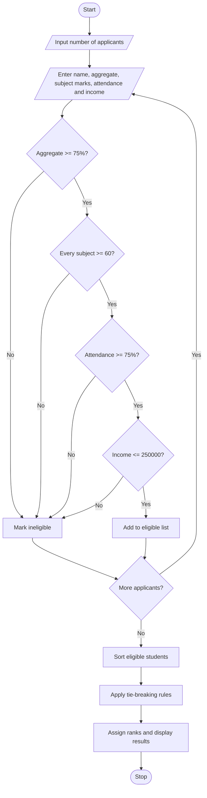

Bro, below is the complete answer for your Python practical assignment. You can write it in your record or save the source code as `code.py`.

# 1. Problem Statement

Design a University Scholarship Allocation System using Python. The system evaluates students based on aggregate percentage, subject-wise minimum marks, attendance percentage, and annual family income. It identifies eligible students, ranks them according to aggregate marks, and resolves ties using higher attendance, lower family income, and alphabetical order of names.

Eligibility criteria (assumed for this program):

- Aggregate percentage ≥ 75%
- Every subject mark ≥ 60 out of 100
- Attendance ≥ 75%
- Annual family income ≤ ₹2,50,000

# 2. Algorithm

1. Start.
2. Read the number of student applicants.
3. Enter each student's name, aggregate percentage, subject marks, attendance, and family income.
4. Check all scholarship eligibility conditions.
5. If all conditions are satisfied, add the student to the eligible list.
6. Otherwise, display the reason for ineligibility.
7. Sort eligible students by:
   - Aggregate percentage: highest first.
   - Attendance: highest first in case of a tie.
   - Family income: lowest first if still tied.
   - Name: alphabetical order if still tied.
8. Assign ranks to eligible students.
9. Display the scholarship ranking list.
10. Stop.

# 3. Flowchart

# 4. Python Source Code

Save this program as `code.py`.

```
    if any(mark < MIN_SUBJECT_MARK for mark in subjects):        reasons.append("Subject marks below 60")    if attendance < MIN_ATTENDANCE:        reasons.append("Attendance below 75%")    if income > MAX_INCOME:        reasons.append("Family income above Rs. 250000")    student = {        "name": name,        "aggregate": aggregate,        "attendance": attendance,        "income": income    }    if not reasons:        eligible.append(student)    else:        ineligible.append((name, reasons))# Ranking and tie-breaking ruleseligible.sort(    key=lambda s: (        -s["aggregate"],        -s["attendance"],        s["income"],        s["name"].casefold()    ))print("\n--- SCHOLARSHIP RANKING LIST ---")if eligible:    for rank, student in enumerate(eligible, start=1):        print(            f"Rank {rank}: {student['name']} | "            f"Aggregate: {student['aggregate']}% | "            f"Attendance: {student['attendance']}% | "            f"Income: Rs. {student['income']:.0f}"        )else:    print("No eligible students.")print("\n--- INELIGIBLE STUDENTS ---")if ineligible:    for name, reasons in ineligible:        print(name + ": " + ", ".join(reasons))else:    print("No ineligible students.")print("\nProgram completed.")
```

## 5. Sample Input

Enter these values when you run the program. The prompts are displayed automatically.

```
Enter number of applicants: 3

Enter details of student 1
Student name: Ravi
Aggregate percentage: 90
Number of subjects: 3
Subject 1 marks: 80
Subject 2 marks: 75
Subject 3 marks: 90
Attendance percentage: 85
Annual family income (Rs.): 200000

Enter details of student 2
Student name: Sita
Aggregate percentage: 90
Number of subjects: 3
Subject 1 marks: 70
Subject 2 marks: 80
Subject 3 marks: 85
Attendance percentage: 90
Annual family income (Rs.): 220000

Enter details of student 3
Student name: Arjun
Aggregate percentage: 74
Number of subjects: 3
Subject 1 marks: 65
Subject 2 marks: 70
Subject 3 marks: 80
Attendance percentage: 80
Annual family income (Rs.): 150000
```

## 6. Sample Output

```
--- SCHOLARSHIP RANKING LIST ---
Rank 1: Sita | Aggregate: 90.0% | Attendance: 90.0% | Income: Rs. 220000
Rank 2: Ravi | Aggregate: 90.0% | Attendance: 85.0% | Income: Rs. 200000

--- INELIGIBLE STUDENTS ---
Arjun: Aggregate below 75%

Program completed.
```

Explanation: Sita and Ravi have equal aggregate percentages, but Sita has higher attendance, so she gets Rank 1. Arjun is ineligible because his aggregate percentage is below 75%.

# 7. Mermaid Flowchart Code


## 8. Important Python Concepts Used

| Concept         | Purpose                                     |
| --------------- | ------------------------------------------- |
| `for` loop      | Collects details of all applicants          |
| `if` conditions | Checks scholarship eligibility              |
| `list`          | Stores subject marks and student records    |
| `any()`         | Checks whether any subject mark is below 60 |
| `sort()`        | Ranks eligible students                     |
| `enumerate()`   | Assigns ranks starting from 1               |

Practical exam tip: Remember the eligibility conditions and the sorting key. The negative signs in `-s["aggregate"]` and `-s["attendance"]` arrange those values in descending order; income and name are arranged in ascending order.
