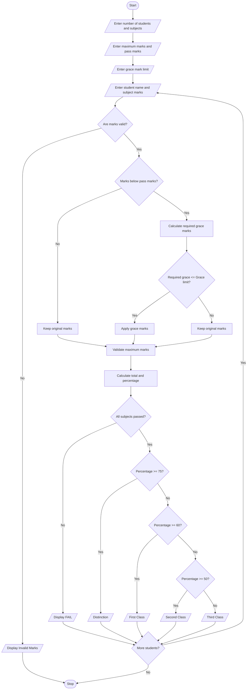

# 1. Problem Statement

Develop a Python program to process examination marks of multiple students across multiple subjects. The program should:

- Accept the number of students and subjects.
- Read subject-wise maximum marks and pass marks.
- Accept marks obtained by each student.
- Apply grace marks to students who fail by a small margin according to the given grace-mark policy.
- Ensure that grace marks do not exceed maximum subject marks.
- Calculate total marks and percentage.
- Display pass/fail status and final classification.

# 2. Algorithm

1. Start the program.
2. Read the number of students and subjects.
3. Read maximum marks and minimum pass marks for each subject.
4. Read the maximum grace marks allowed per subject.
5. For each student:
   - Read the student name.
   - Read marks in all subjects.
   - Check whether marks are valid.
   - Calculate the difference between obtained marks and pass marks.
   - If the student fails within the grace-mark limit, apply grace marks.
   - Ensure final marks do not exceed maximum marks.
   - Calculate total marks and percentage.
   - Check pass/fail status.
6. If all subjects are passed, classify the student:
   - 75% and above – Distinction.
   - 60% and above – First Class.
   - 50% and above – Second Class.
   - Below 50% – Third Class.
7. Otherwise, display Fail.
8. Display the final result.
9. Stop.

# 3. Flowchart

# 4. Python Source Code

```
    for i in range(subjects):        mark = int(input("Enter marks in subject " + str(i + 1) + ": "))        if mark < 0 or mark > max_marks[i]:            print("Invalid marks entered!")            exit()        # Apply grace marks if eligible        if mark < pass_marks[i]:            required = pass_marks[i] - mark            if required <= grace_limit:                mark = min(mark + required, max_marks[i])                print("Grace marks applied in subject", i + 1)        marks.append(mark)        final_marks.append(mark)    total = sum(final_marks)    maximum_total = sum(max_marks)    percentage = (total / maximum_total) * 100    print("\n----- FINAL RESULT -----")    print("Student Name:", name)    for i in range(subjects):        print("Subject", i + 1, ":", final_marks[i],              "/", max_marks[i])    print("Total Marks:", total, "/", maximum_total)    print("Percentage:", round(percentage, 2), "%")    # Check final result    if all(final_marks[i] >= pass_marks[i]           for i in range(subjects)):        print("Result: PASS")        if percentage >= 75:            print("Classification: Distinction")        elif percentage >= 60:            print("Classification: First Class")        elif percentage >= 50:            print("Classification: Second Class")        else:            print("Classification: Third Class")    else:        print("Result: FAIL")        print("Classification: Not Classified")print("\nExamination Result Processing Completed!")
```

# 5. Sample Input

```
Enter number of students: 2
Enter number of subjects: 3

Subject 1
Enter maximum marks: 100
Enter pass marks: 40

Subject 2
Enter maximum marks: 100
Enter pass marks: 40

Subject 3
Enter maximum marks: 100
Enter pass marks: 40

Enter maximum grace marks allowed: 5

----- Student 1 -----
Enter student name: Ravi
Enter marks in subject 1: 85
Enter marks in subject 2: 38
Enter marks in subject 3: 90

----- Student 2 -----
Enter student name: Kumar
Enter marks in subject 1: 35
Enter marks in subject 2: 65
Enter marks in subject 3: 70
```

# 6. Sample Output

```
----- Student 1 -----
Grace marks applied in subject 2

----- FINAL RESULT -----
Student Name: Ravi
Subject 1 : 85 / 100
Subject 2 : 40 / 100
Subject 3 : 90 / 100

Total Marks: 215 / 300
Percentage: 71.67 %
Result: PASS
Classification: First Class

----- Student 2 -----

----- FINAL RESULT -----
Student Name: Kumar
Subject 1 : 35 / 100
Subject 2 : 65 / 100
Subject 3 : 70 / 100

Total Marks: 170 / 300
Percentage: 56.67 %
Result: FAIL
Classification: Not Classified

Examination Result Processing Completed!
```

# 7. Mermaid Flowchart Code

