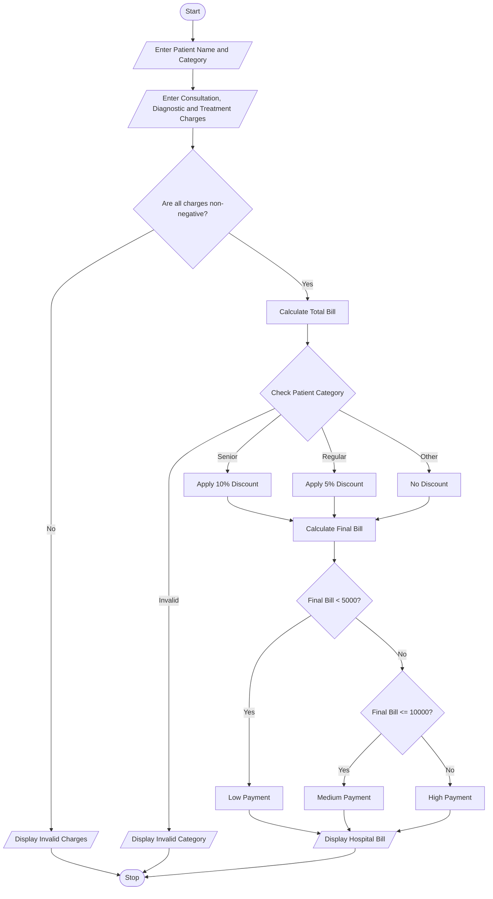

# Unit Task: Hospital Billing and Patient Classification

## 1. Problem Statement

Develop a Python program to calculate a patient's hospital bill by processing consultation charges, diagnostic charges, and treatment charges. Apply conditional concessions based on patient category, validate billing constraints, and classify patients according to the payment policy.

## 2. Algorithm

1. Start the program.
2. Read the patient's name and patient category.
3. Read consultation, diagnostic, and treatment charges.
4. Validate that all charges are non-negative.
5. Calculate the total bill by adding all charges.
6. Apply concessions based on patient category:
   - Senior Citizen: 10% discount.
   - Regular Patient: 5% discount.
   - Other Patients: No discount.
7. Calculate the final bill after discount.
8. Classify the patient based on the final bill:
   - Below ₹5,000: Low Payment.
   - ₹5,000 to ₹10,000: Medium Payment.
   - Above ₹10,000: High Payment.
9. Display the total bill, discount, final bill, and patient classification.
10. Stop the program.

## 3. Flowchart

## 4. Python Source Code

Filename: `Hospital_Billing_and_Patient_Classification.py`

```
# Hospital Billing and Patient Classification# Input patient detailsname = input("Enter patient name: ")category = input("Enter patient category (Senior/Regular/Other): ").strip().lower()# Input hospital chargesconsultation = float(input("Enter consultation charges: "))diagnostic = float(input("Enter diagnostic charges: "))treatment = float(input("Enter treatment charges: "))# Validate billing constraintsif consultation < 0 or diagnostic < 0 or treatment < 0:    print("Invalid charges! Charges cannot be negative.")else:    # Calculate total bill    total_bill = consultation + diagnostic + treatment    # Apply conditional concessions    if category == "senior":        discount_rate = 0.10    elif category == "regular":        discount_rate = 0.05    elif category == "other":        discount_rate = 0.0    else:        discount_rate = -1    if discount_rate == -1:        print("Invalid patient category!")    else:        # Calculate discount and final bill        discount = total_bill * discount_rate        final_bill = total_bill - discount        # Patient classification        if final_bill < 5000:            classification = "Low Payment"        elif final_bill <= 10000:            classification = "Medium Payment"        else:            classification = "High Payment"        # Display bill details        print("\n----- HOSPITAL BILL -----")        print("Patient Name:", name)        print("Patient Category:", category.title())        print("Consultation Charges: Rs.", consultation)        print("Diagnostic Charges: Rs.", diagnostic)        print("Treatment Charges: Rs.", treatment)        print("Total Bill: Rs.", total_bill)        print("Discount: Rs.", discount)        print("Final Bill: Rs.", final_bill)        print("Patient Classification:", classification)
```

## 5. Sample Input

```
Enter patient name: Ravi
Enter patient category (Senior/Regular/Other): Senior
Enter consultation charges: 1000
Enter diagnostic charges: 2000
Enter treatment charges: 5000
```

## 6. Sample Output

```
----- HOSPITAL BILL -----

Patient Name: Ravi
Patient Category: Senior

Consultation Charges: Rs. 1000.0
Diagnostic Charges: Rs. 2000.0
Treatment Charges: Rs. 5000.0

Total Bill: Rs. 8000.0
Discount: Rs. 800.0
Final Bill: Rs. 7200.0

Patient Classification: Medium Payment
```

## 7. Mermaid Flowchart Code


## 8. Sample Test Cases

| Patient category | Total bill | Discount | Final bill |
| ---------------- | ---------- | -------- | ---------- |
| Senior           | ₹8,000     | ₹800     | ₹7,200     |
| Regular          | ₹6,000     | ₹300     | ₹5,700     |
| Other            | ₹12,000    | ₹0       | ₹12,000    |
| Senior           | ₹4,000     | ₹400     | ₹3,600     |

Note: The discount rates and payment classification limits are assumed for this programming exercise. They can be changed according to the supplied payment policy.
