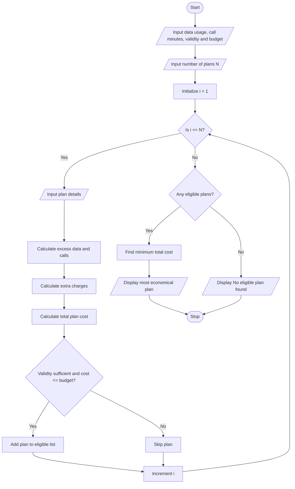

# Multi-Plan Telecommunications Cost Optimization

## 1. Problem Statement

Develop a Python program to evaluate multiple mobile recharge plans based on data usage, call minutes, validity, and budget constraints. The program calculates the total cost of each plan, including excess usage charges. It identifies eligible plans that satisfy the user's requirements and selects the most economical plan.

## 2. Algorithm

1. Start the program.
2. Read the user's data usage, call minutes, required validity, and budget.
3. Read the number of available mobile plans.
4. For each plan, input:
   - Plan name
   - Base price
   - Included data
   - Included call minutes
   - Validity days
   - Extra data charge per GB
   - Extra call charge per minute
5. Calculate excess data usage.
6. Calculate excess call charges.
7. Calculate the total cost of each plan.
8. Check whether the plan satisfies validity and budget constraints.
9. Compare the costs of all eligible plans.
10. Identify the plan with the lowest total cost.
11. Display all plan details and the most economical eligible plan.
12. If no plan is eligible, display a suitable message.
13. Stop.

## 3. Flowchart



## 4. Python Source Code

File name: `Multi_Plan_Telecommunications_Cost_Optimization.py`

```
    validity = int(input("Enter validity days: "))    extra_data_rate = float(input("Extra data charge per GB: "))    extra_call_rate = float(input("Extra call charge per minute: "))    # Calculate excess usage    extra_data = max(0, usage_data - data)    extra_calls = max(0, usage_calls - calls)    # Calculate additional charges    data_charge = extra_data * extra_data_rate    call_charge = extra_calls * extra_call_rate    # Calculate total cost    total_cost = price + data_charge + call_charge    plans.append((name, total_cost, validity))    print("\nPlan:", name)    print("Base Price: Rs.", price)    print("Extra Data Charge: Rs.", data_charge)    print("Extra Call Charge: Rs.", call_charge)    print("Total Cost: Rs.", total_cost)    # Check eligibility    if validity >= required_validity and total_cost <= budget:        eligible_plans.append((name, total_cost, validity))# Display resultprint("\n----- PLAN COMPARISON -----")if len(eligible_plans) > 0:    best_plan = min(eligible_plans, key=lambda x: x[1])    print("Eligible Plans:")    for plan in eligible_plans:        print(plan[0], "- Rs.", plan[1])    print("\n----- BEST PLAN -----")    print("Plan Name:", best_plan[0])    print("Total Cost: Rs.", best_plan[1])    print("Validity:", best_plan[2], "days")    print("Most Economical Eligible Plan Found!")else:    print("No eligible plan found within your budget.")print("\nProgram Completed.")
```

## 5. Sample Input

```
Enter required data usage (GB): 3
Enter required call minutes: 500
Enter required validity days: 28
Enter your budget (Rs): 300
Enter number of mobile plans: 3

Enter details of Plan 1
Enter plan name: Basic
Enter base price: 149
Enter included data (GB): 2
Enter included call minutes: 300
Enter validity days: 28
Extra data charge per GB: 20
Extra call charge per minute: 0.5

Enter details of Plan 2
Enter plan name: Smart
Enter base price: 249
Enter included data (GB): 4
Enter included call minutes: 600
Enter validity days: 56
Extra data charge per GB: 15
Extra call charge per minute: 0.5

Enter details of Plan 3
Enter plan name: Premium
Enter base price: 399
Enter included data (GB): 6
Enter included call minutes: 1000
Enter validity days: 84
Extra data charge per GB: 10
Extra call charge per minute: 0.5
```

## 6. Sample Output

```
Plan: Basic
Base Price: Rs. 149
Extra Data Charge: Rs. 20.0
Extra Call Charge: Rs. 100.0
Total Cost: Rs. 269.0

Plan: Smart
Base Price: Rs. 249
Extra Data Charge: Rs. 0
Extra Call Charge: Rs. 0
Total Cost: Rs. 249.0

Plan: Premium
Base Price: Rs. 399
Extra Data Charge: Rs. 0
Extra Call Charge: Rs. 0
Total Cost: Rs. 399.0

----- PLAN COMPARISON -----
Eligible Plans:
Basic - Rs. 269.0
Smart - Rs. 249.0

----- BEST PLAN -----
Plan Name: Smart
Total Cost: Rs. 249.0
Validity: 56 days
Most Economical Eligible Plan Found!

Program Completed.
```

## 7. Mermaid Flowchart Code


## 8. Expected Result

The program evaluates all available mobile plans, calculates additional usage charges, checks the budget and validity constraints, and displays the cheapest eligible mobile plan.
