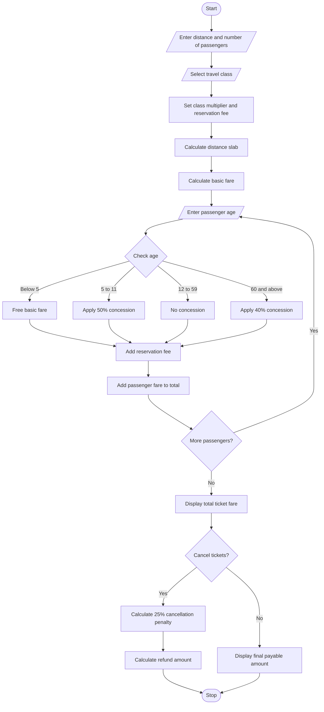

# 6. Railway Fare and Reservation Calculator

## 1. Problem Statement

Develop a Python program to calculate railway ticket fares for multiple passengers based on distance travelled, travel class, age-based concessions, reservation fees, and cancellation penalties.

The program should:

- Accept the number of passengers.
- Calculate basic fare based on distance slabs.
- Apply different fares for travel classes.
- Provide age-based concessions for eligible passengers.
- Add reservation charges.
- Calculate cancellation penalties when applicable.
- Display the total fare and final payable amount.

## 2. Algorithm

1. Start the program.
2. Read the number of passengers.
3. Read the journey distance.
4. Select the travel class.
5. Calculate the basic fare based on distance slabs.
6. Apply the class multiplier.
7. Read each passenger's age.
8. Apply age-based concessions:
   - Below 5 years: Free ticket.
   - 5 to 11 years: 50% concession.
   - 60 years and above: 40% concession.
   - Others: No concession.
9. Add reservation charges for each passenger.
10. Calculate the total ticket fare.
11. Ask whether the ticket is cancelled.
12. If cancelled, calculate a 25% cancellation penalty.
13. Display the passenger-wise fare and final amount.
14. Stop the program.

## 3. Flowchart

## 4. Python Source Code

```
    reservation = 50    class_name = "AC 2 Tier"elif choice == 4:    rate = 4.0    reservation = 60    class_name = "AC First Class"else:    print("Invalid class selection")    exit()# Distance slab calculationif distance <= 100:    base_rate = 1elif distance <= 300:    base_rate = 1.5elif distance <= 500:    base_rate = 2else:    base_rate = 2.5basic_fare = distance * base_rate * ratetotal_fare = 0# Passenger detailsfor i in range(1, n + 1):    print("\nPassenger", i)    age = int(input("Enter passenger age: "))    if age < 5:        fare = 0    elif age <= 11:        fare = basic_fare * 0.50    elif age >= 60:        fare = basic_fare * 0.60    else:        fare = basic_fare    passenger_total = fare + reservation    print("Basic Fare:", fare)    print("Reservation Fee:", reservation)    print("Passenger Total:", passenger_total)    total_fare += passenger_totalprint("\nTotal Ticket Fare:", total_fare)# Cancellationcancel = input("Do you want to cancel tickets? (yes/no): ")if cancel.lower() == "yes":    penalty = total_fare * 0.25    refund = total_fare - penalty    print("Cancellation Penalty:", penalty)    print("Refund Amount:", refund)else:    print("Cancellation Penalty: 0")    print("Final Payable Amount:", total_fare)print("\n===== THANK YOU =====")
```

## 5. Sample Input

```
===== RAILWAY FARE CALCULATOR =====

Enter journey distance in KM: 200
Enter number of passengers: 3

Select Travel Class
1. Sleeper
2. AC 3 Tier
3. AC 2 Tier
4. AC First Class

Enter your choice: 1

Passenger 1
Enter passenger age: 25

Passenger 2
Enter passenger age: 65

Passenger 3
Enter passenger age: 10

Do you want to cancel tickets? (yes/no): no
```

## 6. Sample Output

```
===== RAILWAY FARE CALCULATOR =====

Passenger 1
Basic Fare: 300.0
Reservation Fee: 20
Passenger Total: 320.0

Passenger 2
Basic Fare: 180.0
Reservation Fee: 20
Passenger Total: 200.0

Passenger 3
Basic Fare: 150.0
Reservation Fee: 20
Passenger Total: 170.0

Total Ticket Fare: 690.0

Cancellation Penalty: 0
Final Payable Amount: 690.0

===== THANK YOU =====
```

## 7. Mermaid Flow chart

