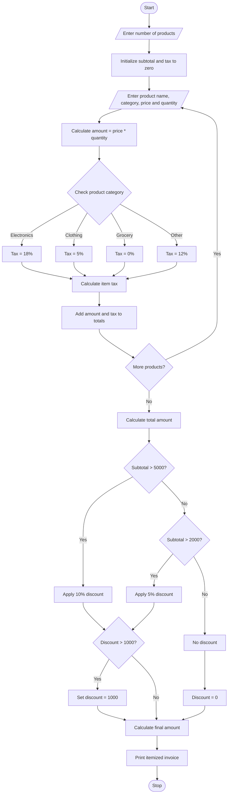

# Retail Billing with Multiple Discount Rules

## 1. Problem Statement

Develop a Python program to generate a retail bill for multiple products. The program should accept product names, quantities, prices, and categories. It must calculate the subtotal, apply category-specific taxes, provide discounts based on purchase thresholds, and ensure that the total discount does not exceed the maximum concession limit. Finally, it should generate an itemized invoice showing product details, discounts, taxes, and the final payable amount.

## 2. Algorithm

1. Start the program.
2. Read the number of products.
3. Initialize the subtotal to zero.
4. For each product:
   - Read product name.
   - Read product category.
   - Read price and quantity.
   - Calculate the item amount.
   - Calculate category-specific tax.
   - Add the item amount to the subtotal.
5. Calculate the total amount before discount.
6. Check the purchase amount for discount eligibility.
7. Apply the threshold discount:
   - 10% discount for purchases above ₹5,000.
   - 5% discount for purchases above ₹2,000.
   - No discount otherwise.
8. Apply the maximum concession limit of ₹1,000.
9. Calculate the final payable amount.
10. Display the itemized invoice.
11. Stop.

## 3. Input – Process – Output

| Input              | Process                | Output           |
| ------------------ | ---------------------- | ---------------- |
| Number of products | Calculate subtotal     | Product details  |
| Product name       | Calculate tax          | Tax amount       |
| Category           | Apply discount         | Discount amount  |
| Quantity           | Check concession limit | Final bill       |
| Price              | Calculate total        | Itemized invoice |

Tax rules:

- Electronics: 18%
- Clothing: 5%
- Grocery: 0%
- Other: 12%

Discount rules:

- Above ₹5,000: 10%
- Above ₹2,000: 5%
- Otherwise: 0%
- Maximum discount: ₹1,000

## 4. Flowchart

## 5. Python Source Code

```
    if category == "electronics":        tax_rate = 18    elif category == "clothing":        tax_rate = 5    elif category == "grocery":        tax_rate = 0    else:        tax_rate = 12    tax = amount * tax_rate / 100    subtotal += amount    total_tax += tax    items.append([name, quantity, price, amount, tax])# Calculate total before discounttotal = subtotal + total_tax# Apply threshold discountif subtotal > 5000:    discount_rate = 10elif subtotal > 2000:    discount_rate = 5else:    discount_rate = 0discount = subtotal * discount_rate / 100# Maximum concession limitif discount > 1000:    discount = 1000# Final billfinal_amount = total - discount# Display invoiceprint("\n========== RETAIL INVOICE ==========")print("\nProduct\tQty\tPrice\tAmount\tTax")for item in items:    print(item[0], "\t", item[1], "\t",          item[2], "\t", item[3], "\t", item[4])print("------------------------------------")print("Subtotal       : Rs.", round(subtotal, 2))print("Total Tax      : Rs.", round(total_tax, 2))print("Discount       : Rs.", round(discount, 2))print("Final Amount   : Rs.", round(final_amount, 2))print("====================================")print("Thank you for shopping!")
```

## 6. Sample Input

```
===== RETAIL BILLING SYSTEM =====

Enter number of products: 3

Enter details of Product 1
Product Name: Laptop
Category: electronics
Price: 40000
Quantity: 1

Enter details of Product 2
Product Name: Shirt
Category: clothing
Price: 1000
Quantity: 2

Enter details of Product 3
Product Name: Rice
Category: grocery
Price: 500
Quantity: 2
```

## 7. Sample Output

```
========== RETAIL INVOICE ==========

Product Qty Price Amount Tax

Laptop    1   40000   40000   7200
Shirt     2    1000    2000    100
Rice      2     500    1000      0

------------------------------------
Subtotal       : Rs. 43000.00
Total Tax      : Rs. 7300.00
Discount       : Rs. 1000.00
Final Amount   : Rs. 49300.00

====================================
Thank you for shopping!
```

## 8. Mermaid Flowchart Code


Important practical note: This program uses the subtotal before tax to determine discount eligibility, and the maximum discount is ₹1,000. The discount is deducted from the total including 
