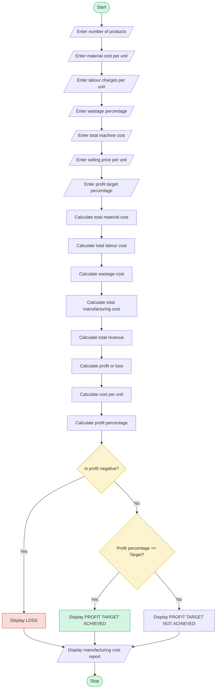

# Manufacturing Cost and Profitability Analysis

## 1. Problem Statement

Develop a Python program to calculate the total manufacturing cost and profitability of a product by considering material costs, labour charges, wastage, machine costs, and selling price.

The program should calculate the total production cost, cost per unit, total revenue, profit or loss, and profit percentage. Finally, it should identify whether the production meets the specified profit target.

## 2. Algorithm

1. Start the program.
2. Read the number of products manufactured.
3. Read the material cost per unit.
4. Read the labour charges per unit.
5. Read the wastage percentage.
6. Read the total machine cost.
7. Read the selling price per unit.
8. Read the required profit target percentage.
9. Calculate the total material cost.
10. Calculate the total labour cost.
11. Calculate the wastage cost.
12. Calculate the total manufacturing cost.
13. Calculate the total selling revenue.
14. Calculate the profit or loss.
15. Calculate the profit percentage.
16. Compare the actual profit percentage with the target.
17. Display the complete cost and profit analysis.
18. Stop the program.

## 3. Flowchart

## 4. Python Source Code

```
# Manufacturing Cost and Profitability Analysis# Input sectionquantity = int(input("Enter number of products: "))material_cost = float(input("Enter material cost per unit: "))labour_cost = float(input("Enter labour charges per unit: "))wastage_percent = float(input("Enter wastage percentage: "))machine_cost = float(input("Enter total machine cost: "))selling_price = float(input("Enter selling price per unit: "))profit_target = float(input("Enter profit target percentage: "))# Process sectiontotal_material = quantity * material_costtotal_labour = quantity * labour_costwastage_cost = (total_material * wastage_percent) / 100total_manufacturing_cost = (    total_material +    total_labour +    wastage_cost +    machine_cost)total_revenue = quantity * selling_priceprofit = total_revenue - total_manufacturing_cost
```

## 5. Sample Input

```
Enter number of products: 100
Enter material cost per unit: 200
Enter labour charges per unit: 50
Enter wastage percentage: 10
Enter total machine cost: 2000
Enter selling price per unit: 350
Enter profit target percentage: 20
```

## 6. Sample Output

```
----- MANUFACTURING COST REPORT -----

Total Products: 100
Total Material Cost: 20000.0
Total Labour Cost: 5000.0
Wastage Cost: 2000.0
Machine Cost: 2000.0
Total Manufacturing Cost: 29000.0
Cost Per Unit: 290.0
Total Selling Revenue: 35000.0
Profit / Loss: 6000.0
Profit Percentage: 20.689655172413794 %

----- PROFITABILITY ANALYSIS -----

Production Result: PROFIT TARGET ACHIEVED
```

## 7. Mermaid Flowchart Code


## 8. Result

The Python program successfully calculates material costs, labour charges, wastage costs, machine costs, total manufacturing expenses, selling revenue, and profit percentage.


