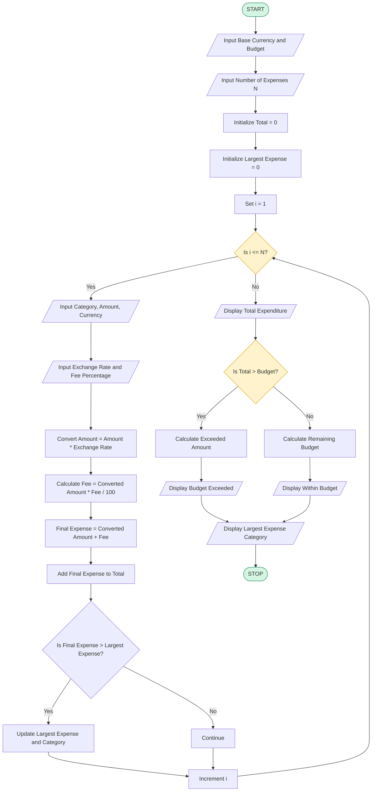

# Multi-Currency Travel Budget Analysis

## 1. Problem Statement

Develop a Python program to analyze a travel budget by converting expenses from different currencies into a common base currency using supplied exchange rates. The program should calculate currency conversion fees, determine the total travel expenditure, compare the total expenditure with the planned budget, identify whether the budget is exceeded or within limits, and find the largest expense category.

## 2. Algorithm

1. Start the program.
2. Read the base currency.
3. Read the total travel budget.
4. Read the number of expense categories.
5. For each expense category:
   - Read the category name.
   - Read the expense amount.
   - Read the currency code.
   - Read the exchange rate.
   - Read the conversion fee percentage.
6. Convert the expense into the base currency.
7. Calculate the conversion fee.
8. Calculate the total expense including the fee.
9. Add the expense to the total travel expenditure.
10. Identify the largest expense category.
11. Compare total expenditure with the planned budget.
12. Display the converted expenses, fees, total expenditure, remaining budget or exceeded amount, and largest expense category.
13. Stop the program.

## 3. Flowchart

## 4. Python Source Code

Complete Python program

```
# Multi-Currency Travel Budget Analysisprint("MULTI-CURRENCY TRAVEL BUDGET ANALYSIS")# Input base currency and budgetbase_currency = input("Enter base currency: ").upper()budget = float(input("Enter travel budget: "))n = int(input("Enter number of expense categories: "))total_expense = 0largest_expense = 0largest_category = ""# Process multiple expensesfor i in range(n):    print("\nExpense", i + 1)    category = input("Enter expense category: ")    amount = float(input("Enter expense amount: "))    currency = input("Enter currency code: ").upper()    exchange_rate = float(input("Enter exchange rate: "))    fee_percent = float(input("Enter conversion fee percentage: "))    # Convert expense into base currency    converted_amount = amount * exchange_rate    # Calculate conversion fee    conversion_fee = converted_amount * fee_percent / 100    # Calculate final expense    final_expense = converted_amount + conversion_fee    # Add to total expense    total_expense += final_expense    # Find largest expense category    if final_expense > largest_expense:        largest_expense = final_expense        largest_category = category    # Display individual expense    print("Converted Amount:", round(converted_amount, 2))    print("Conversion Fee:", round(conversion_fee, 2))    print("Final Expense:", round(final_expense, 2))# Compare expenditure with budgetprint("\n------ TRAVEL BUDGET SUMMARY ------")print("Base Currency:", base_currency)print("Total Budget:", round(budget, 2))print("Total Expenditure:", round(total_expense, 2))if total_expense > budget:    exceeded = total_expense - budget    print("Budget Status: Budget Exceeded")    print("Exceeded Amount:", round(exceeded, 2))else:    remaining = budget - total_expense    print("Budget Status: Within Budget")    print("Remaining Budget:", round(remaining, 2))
```

## 5. Sample Input

Assume the base currency is INR.

```
MULTI-CURRENCY TRAVEL BUDGET ANALYSIS

Enter base currency: INR
Enter travel budget: 100000
Enter number of expense categories: 3

Expense 1
Enter expense category: Hotel
Enter expense amount: 200
Enter currency code: USD
Enter exchange rate: 85
Enter conversion fee percentage: 2

Expense 2
Enter expense category: Food
Enter expense amount: 100
Enter currency code: EUR
Enter exchange rate: 95
Enter conversion fee percentage: 1

Expense 3
Enter expense category: Shopping
Enter expense amount: 300
Enter currency code: AED
Enter exchange rate: 23
Enter conversion fee percentage: 2
```

## 6. Sample Output

```
MULTI-CURRENCY TRAVEL BUDGET ANALYSIS

Expense 1
Converted Amount: 17000.0
Conversion Fee: 340.0
Final Expense: 17340.0

Expense 2
Converted Amount: 9500.0
Conversion Fee: 95.0
Final Expense: 9595.0

Expense 3
Converted Amount: 6900.0
Conversion Fee: 138.0
Final Expense: 7038.0

------ TRAVEL BUDGET SUMMARY ------

Base Currency: INR
Total Budget: 100000.0
Total Expenditure: 33973.0
Budget Status: Within Budget
Remaining Budget: 66027.0
Largest Expense Category: Hotel
Largest Expense Amount: 17340.0

-----------------------------------
Analysis Completed
```

## 7. Mermaid Flowchart Code


## 8. Important Formulas

| Calculation       | Formula                        |
| ----------------- | ------------------------------ |
| Converted Amount  | Amount × Exchange Rate         |
| Conversion Fee    | Converted Amount × Fee % / 100 |
| Final Expense     | Converted Amount + Fee         |
| Total Expenditure | Sum of all final expenses      |
| Remaining Budget  | Budget − Total Expenditure     |
| Exceeded Amount   | Total Expenditure − Budget     |


