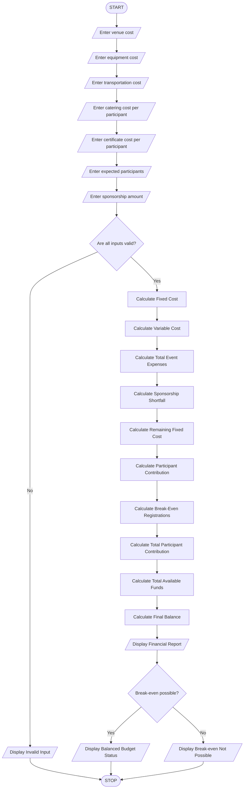

# Campus Event Financial Planning

## 1. Problem Statement

Develop a Python program to calculate the total expenses for organizing a campus event. The program should consider venue charges, equipment costs, catering expenses, transportation costs, and certificate costs.

It should calculate the total event budget, sponsorship amount, sponsorship shortfall, participant contribution, and minimum number of registrations required to break even.

The program should also determine whether the event budget can be covered by the available sponsorship and registration contributions.

## 2. Algorithm

1. Start the program.
2. Read venue cost.
3. Read equipment cost.
4. Read catering cost per participant.
5. Read transportation cost.
6. Read certificate cost per participant.
7. Read expected number of participants.
8. Read sponsorship amount.
9. Calculate total fixed costs.
10. Calculate variable cost per participant.
11. Calculate total event expenses.
12. Calculate sponsorship shortfall.
13. Calculate remaining amount after sponsorship.
14. Calculate participant contribution per person.
15. Calculate minimum registrations required to break even.
16. Display all financial details.
17. Stop the program.

## 3. IPO (Input, Process, Output)

| Input            | Process                                 | Output                        |
| ---------------- | --------------------------------------- | ----------------------------- |
| Venue cost       | Calculate fixed cost                    | Total fixed cost              |
| Equipment cost   | Calculate variable cost                 | Variable cost per participant |
| Catering cost    | Calculate total expenses                | Total event expenses          |
| Transport cost   | Subtract sponsorship                    | Sponsorship shortfall         |
| Certificate cost | Divide remaining amount by participants | Participant contribution      |
| Participants     | Calculate break-even registrations      | Minimum registrations         |
| Sponsorship      | Compare revenue and expenses            | Financial status              |

## 4. Flowchart


## 5. Python Source Code

Complete Python program

```
import math    print("Invalid input! Enter valid positive values.")else:    # Fixed and variable costs    fixed_cost = venue + equipment + transport    variable_cost = catering + certificate    # Total event expenses    total_expenses = fixed_cost + (variable_cost * participants)    # Sponsorship shortfall    sponsorship_shortfall = max(0, total_expenses - sponsorship)    # Remaining fixed cost after sponsorship    remaining_fixed = max(0, fixed_cost - sponsorship)    # Participant contribution per person    contribution = variable_cost + (        remaining_fixed / participants    )    # Total participant contribution    total_contribution = contribution * participants    # Break-even registration count    if remaining_fixed == 0:        break_even = 0    elif contribution > variable_cost:        break_even = math.ceil(            remaining_fixed / (contribution - variable_cost)        )    else:        break_even = -1    # Total available funds    total_funds = sponsorship + total_contribution    # Financial status    balance = total_funds - total_expenses    # Output    print("\n===== EVENT FINANCIAL REPORT =====")    print("Fixed Cost:", fixed_cost)    print("Variable Cost Per Participant:", variable_cost)    print("Total Event Expenses:", total_expenses)    print("Sponsorship Amount:", sponsorship)    print("Sponsorship Shortfall:", sponsorship_shortfall)    print("Participant Contribution:", contribution)    print("Total Participant Contribution:", total_contribution)    print("Minimum Break-Even Registrations:", break_even)    print("Total Available Funds:", total_funds)    print("Final Balance:", balance)    if break_even == -1:        print("Status: Break-even is not possible.")    else:        print("Status: Event budget is balanced.")
```

## 6. Sample Input

```
===== CAMPUS EVENT FINANCIAL PLANNING =====

Enter venue cost: 20000
Enter equipment cost: 10000
Enter transportation cost: 5000
Enter catering cost per participant: 300
Enter certificate cost per participant: 50
Enter expected number of participants: 100
Enter sponsorship amount: 20000
```

## 7. Sample Output

```
===== EVENT FINANCIAL REPORT =====

Fixed Cost: 35000.0
Variable Cost Per Participant: 350.0
Total Event Expenses: 70000.0

Sponsorship Amount: 20000.0
Sponsorship Shortfall: 50000.0

Participant Contribution: 500.0
Total Participant Contribution: 50000.0

Minimum Break-Even Registrations: 100

Total Available Funds: 70000.0
Final Balance: 0.0

Status: Event budget is balanced.
```

## 8. Flowchart (Step-by-Step)

```
          START
            |
            v
      Enter all costs
            |
            v
    Enter participants
            |
            v
    Enter sponsorship
            |
            v
      Validate inputs
            |
       Valid?
       /    \
     No      Yes
     |        |
     v        v
  Display   Calculate
   Error    Fixed Cost
              |
              v
       Calculate Variable Cost
              |
              v
       Calculate Total Expenses
              |
              v
       Calculate Sponsorship
           Shortfall
              |
              v
       Calculate Participant
           Contribution
              |
              v
       Calculate Break-Even
          Registrations
              |
              v
        Display Report
              |
              v
             STOP
```

## 9. Mermaid Flowchart Code


## 10. Important Formulas

| Calculation              | Formula                                               |
| ------------------------ | ----------------------------------------------------- |
| Fixed cost               | Venue + Equipment + Transport                         |
| Variable cost            | Catering + Certificate                                |
| Total expenses           | Fixed cost + (Variable cost × Participants)           |
| Sponsorship shortfall    | Maximum of (Total expenses − Sponsorship, 0)          |
| Participant contribution | Variable cost + Remaining fixed cost / Participants   |
| Break-even registrations | Remaining fixed cost / (Contribution − Variable cost) |


